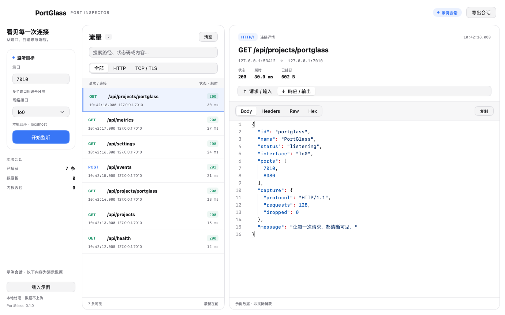

# PortGlass

A native macOS port inspector, built in Go with [MyGo](https://github.com/egoist/mygo).

输入端口，查看经过它的请求与返回。PortGlass 将类似 `ngrep` 的被动抓包放进一个原生 Mac 窗口：液态玻璃侧栏、实时流量列表、可搜索的请求与响应详情。



界面渲染使用明确标记的示例数据；运行中的窗口侧栏使用 macOS 系统材质。

## 下载与使用

在 [Releases](https://github.com/liangzhiyu/portglass/releases) 下载 Apple 芯片版 DMG，打开后将 **PortGlass.app** 拖入 Applications。

1. 输入一个或多个端口，例如 `7010,8080`。
2. 本机服务选择 `lo0`；其他网络流量选择对应网卡，例如 `en0`。
3. 点击 **开始监听**，按 macOS 系统对话框完成管理员授权。
4. 向服务发送请求，选择列表中的记录，查看输入与输出。

可以搜索路径、状态码、地址和内容，也可以复制当前视图或导出整个会话为 JSON。导出的二进制字段使用 JSON 的 Base64 编码。抓包结果仅保存在内存中，除非手动导出，不写入磁盘、不上传服务器。导出文件可能包含实际请求中的令牌、Cookie 等内容，请在分享前检查。

**首版为 ad-hoc 签名、未经 Apple 公证的构建。** 首次打开可能需要在「系统设置 → 隐私与安全性」中允许打开。无需安装 Go、Homebrew、ngrep 或 Wireshark。

## 支持范围

- macOS 14 或更新版本，Apple Silicon（arm64）。macOS 26+ 使用系统 Liquid Glass；旧系统回退为半透明材质。
- 本机回环与可用网卡上的 TCP / IPv4 / IPv6。
- HTTP/1.x 请求与响应配对；处理 TCP 分段、乱序、重传、HTTP keep-alive / pipeline、chunked、gzip、HEAD 和无正文响应。
- Body、Headers、Raw、Hex 视图；JSON 格式化、可选择文本、复制和查找。
- 响应接收过程中可预览已收到的正文，不必等待完整响应结束。
- 普通 TCP 按连接汇总两个方向的字节；TLS 标记为已加密。
- 界面跟随系统明暗主题，支持中文输入、键盘操作和原生文件对话框。

**边界：** HTTPS 不解密；HTTP/2、WebSocket 升级后的内容和其他 TCP 协议以原始字节查看。UDP / QUIC 不在此版本范围内。抓包开始前的内容无法恢复；有缺失的连接会标明捕获不完整。IP 分片不重组。这里的“输入 / 输出”以所选服务端口为参照，连接中途开始且两端都是所选端口时方向可能无法可靠推断。

单方向内容预览最多 64 KiB；HTTP 单条解析上限 2 MiB，超过后显示原始 TCP。历史记录限制为 1,500 条或约 32 MiB 内容，达到上限会移除旧记录并显示数量。内核丢包数始终可见。耗时为捕获到完整请求至完整响应的时间差。

## 抓包方式

使用 macOS 自带的 `libpcap` 和 BPF 端口过滤，不建立代理，不占用被监听的端口，也不修改系统代理、证书信任或 BPF 设备权限。

界面运行于普通用户权限。开始监听时通过系统授权启动同一应用中的独立抓包进程；它打开捕获描述符后立即放弃 root 权限，只通过当前用户私有的 Unix socket 传输数据。停止监听、关闭窗口或 socket 断开都会结束抓包进程。没有常驻 LaunchDaemon。

## 从源码构建

需要 macOS、Go 1.27.3+ 和 Xcode Command Line Tools。MyGo 与依赖版本固定在 `go.mod` / `go.sum`；不需要 Node、Bun 或 CGo。

```sh
go test ./...
CGO_ENABLED=0 go run .
go run github.com/egoist/mygo/cmd/mygo@v0.7.2 build -platform darwin/arm64
```

输出在 `build/darwin-arm64/`。图标资源已提交，无需运行图标生成脚本即可构建。重新生成图标可运行 `swift scripts/icon.swift`。

```sh
# 单独验证真实 loopback 抓包；系统可能要求管理员授权。
go build -o build/portglass .
build/portglass --self-test

# 查看明确标记的示例会话，不抓取任何流量。
go run . --demo

# 渲染宽窗口、小窗口、明暗两种布局。
PORTGLASS_SCREENSHOTS=build/screenshots go test ./internal/app -run TestVisualLayouts
```

真实抓包测试只监听测试程序新建的两个临时 loopback HTTP 端口，不抓取其他端口的数据。

## 发布

`scripts/release.sh` 先运行测试，再构建 arm64 应用，生成 DMG、ZIP 与 SHA256 校验文件。GitHub Actions 在每次推送时验证代码，推送 `v*` 标签时构建并发布 Release。默认使用 ad-hoc 签名；正式的 Developer ID 签名与公证需要自行配置 Apple Developer 凭据。

## License

MIT. Third-party dependencies retain their respective licenses; see [THIRD_PARTY.md](THIRD_PARTY.md).
