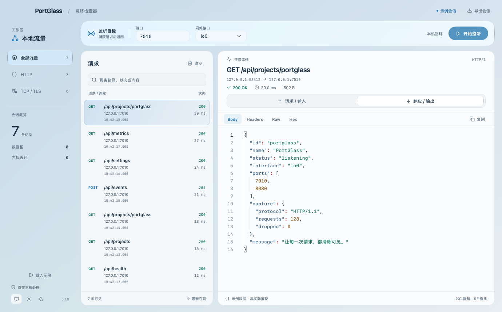
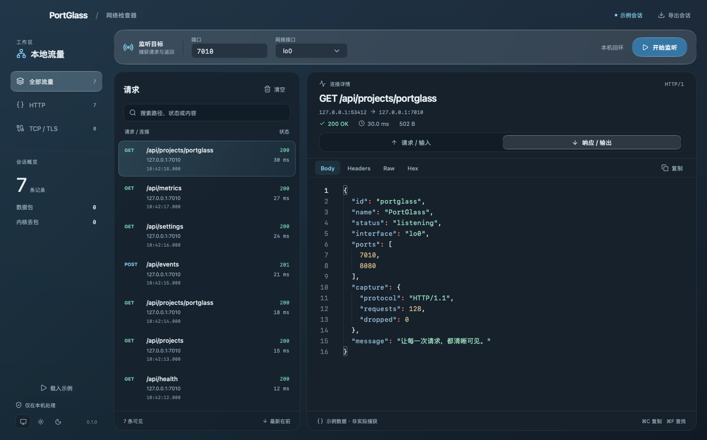

# PortGlass

[](https://awesomemygo.dev/apps/portglass)
[](LICENSE)


> A native macOS port inspector — see HTTP traffic on any port, in a Liquid Glass window.
>
> Type a port, hit Start, watch requests and responses live. No proxy, no cert changes, no Wireshark.

Built in Go with [MyGo](https://github.com/egoist/mygo).





Screenshots are rendered by the app's UI renderer with clearly labeled sample data. The listening bar, navigation selection and direction toggle use MyGo Glass background blur, refraction and highlight shaders, Metal-accelerated on macOS. See [DESIGN.md](docs/DESIGN.md) for design notes.

## Quick Start

Download the Apple Silicon DMG from [Releases](https://github.com/liangzhiyu/portglass/releases), open it and drag **PortGlass.app** to Applications.

1. Enter one or more ports, e.g. `7010,8080`.
2. For local services pick `lo0`; for other network traffic pick the interface, e.g. `en0`.
3. Click **Start listening** and approve the macOS admin prompt.
4. Send requests to your service, pick a record in the list to see request and response.

Search by path, status code, address and body. Copy the current view or export the whole session as JSON (binary fields are Base64 in JSON). Captures stay in memory only — nothing is written to disk or uploaded unless you export. Exported files can contain tokens and cookies from real requests, check before sharing.

**First release is ad-hoc signed, not notarized by Apple.** On first open you may need to allow it in System Settings → Privacy & Security. No need to install Go, Homebrew, ngrep or Wireshark.

## What it does

- macOS 14+, Apple Silicon (arm64). Liquid Glass is implemented with MyGo shaders — no macOS 26 required, not SwiftUI `glassEffect`.
- TCP / IPv4 / IPv6 on loopback and available interfaces.
- HTTP/1.x request/response pairing, with TCP segmentation, out-of-order, retransmission, keep-alive / pipelining, chunked, gzip, HEAD and bodyless responses handled.
- Body, Headers, Raw and Hex views; JSON formatting, selectable text, copy and find.
- Preview response body while it is still arriving, no need to wait for the full response.
- Plain TCP is summarized per connection in both directions; TLS is marked as encrypted.
- Light / Dark / Follow System; respects Reduce Transparency, Increase Contrast and Reduce Motion. Chinese input, keyboard operation and native file dialogs supported.

**Limits:** HTTPS is not decrypted; HTTP/2, post-upgrade WebSocket and other TCP protocols are shown as raw bytes. UDP / QUIC are out of scope for this version. Traffic before capture starts cannot be recovered; incomplete connections are marked as such. IP fragments are not reassembled. “In / Out” is relative to the selected service port — direction may be unreliable when a connection started mid-way and both ends are the selected port.

Preview is up to 64 KiB per direction; single HTTP parse limit is 2 MiB, beyond that shows raw TCP. History is limited to 1,500 entries or ~32 MiB, oldest entries are removed with a count shown. Kernel drop count is always visible. Duration is from complete request captured to complete response captured.

## How capture works

Uses macOS built-in `libpcap` and BPF port filtering. No proxy, no port taken, no changes to system proxy, certificate trust or BPF device permissions.

The UI runs as a normal user. On Start, a separate capture process in the same app is launched with system authorization; it drops root right after opening the capture descriptor and only sends data over a private Unix socket owned by the current user. Stopping, closing the window or socket disconnect ends the capture process. No persistent LaunchDaemon.

---

## 中文说明

输入端口，查看经过它的请求与返回。PortGlass 将类似 `ngrep` 的被动抓包放进一个原生 Mac 窗口：浮动玻璃监听栏、实时流量列表、可搜索的请求与响应详情。

## 下载与使用

在 [Releases](https://github.com/liangzhiyu/portglass/releases) 下载 Apple 芯片版 DMG，打开后将 **PortGlass.app** 拖入 Applications。

1. 输入一个或多个端口，例如 `7010,8080`。
2. 本机服务选择 `lo0`；其他网络流量选择对应网卡，例如 `en0`。
3. 点击 **开始监听**，按 macOS 系统对话框完成管理员授权。
4. 向服务发送请求，选择列表中的记录，查看输入与输出。

可以搜索路径、状态码、地址和内容，也可以复制当前视图或导出整个会话为 JSON。导出的二进制字段使用 JSON 的 Base64 编码。抓包结果仅保存在内存中，除非手动导出，不写入磁盘、不上传服务器。导出文件可能包含实际请求中的令牌、Cookie 等内容，请在分享前检查。

**首版为 ad-hoc 签名、未经 Apple 公证的构建。** 首次打开可能需要在「系统设置 → 隐私与安全性」中允许打开。无需安装 Go、Homebrew、ngrep 或 Wireshark。

## 支持范围

- macOS 14 或更新版本，Apple Silicon（arm64）。液态玻璃由 MyGo 的着色器实现，无需 macOS 26，也不是 SwiftUI 的 `glassEffect`。
- 本机回环与可用网卡上的 TCP / IPv4 / IPv6。
- HTTP/1.x 请求与响应配对；处理 TCP 分段、乱序、重传、HTTP keep-alive / pipeline、chunked、gzip、HEAD 和无正文响应。
- Body、Headers、Raw、Hex 视图；JSON 格式化、可选择文本、复制和查找。
- 响应接收过程中可预览已收到的正文，不必等待完整响应结束。
- 普通 TCP 按连接汇总两个方向的字节；TLS 标记为已加密。
- 浅色 / 深色 / 跟随系统三种外观；尊重系统减少透明度、增加对比度与减少动态效果设置。支持中文输入、键盘操作和原生文件对话框。

**边界：** HTTPS 不解密；HTTP/2、WebSocket 升级后的内容和其他 TCP 协议以原始字节查看。UDP / QUIC 不在此版本范围内。抓包开始前的内容无法恢复；有缺失的连接会标明捕获不完整。IP 分片不重组。这里的“输入 / 输出”以所选服务端口为参照，连接中途开始且两端都是所选端口时方向可能无法可靠推断。

单方向内容预览最多 64 KiB；HTTP 单条解析上限 2 MiB，超过后显示原始 TCP。历史记录限制为 1,500 条或约 32 MiB 内容，达到上限会移除旧记录并显示数量。内核丢包数始终可见。耗时为捕获到完整请求至完整响应的时间差。

## 抓包方式

使用 macOS 自带的 `libpcap` 和 BPF 端口过滤，不建立代理，不占用被监听的端口，也不修改系统代理、证书信任或 BPF 设备权限。

界面运行于普通用户权限。开始监听时通过系统授权启动同一应用中的独立抓包进程；它打开捕获描述符后立即放弃 root 权限，只通过当前用户私有的 Unix socket 传输数据。停止监听、关闭窗口或 socket 断开都会结束抓包进程。没有常驻 LaunchDaemon。

## 从源码构建

需要 macOS、Go 1.27.3+ 和 Xcode Command Line Tools。MyGo 与依赖版本固定在 `go.mod` / `go.sum`；不需要 Node、Bun 或 CGo。

```sh
go test ./...
CGO_ENABLED=0 go run .
go run github.com/egoist/mygo/cmd/mygo@v0.7.2 build -platform darwin/arm64
```

输出在 `build/darwin-arm64/`。图标资源已提交，无需运行图标生成脚本即可构建。重新生成图标可运行 `swift scripts/icon.swift`。

```sh
# 单独验证真实 loopback 抓包；系统可能要求管理员授权。
go build -o build/portglass .
build/portglass --self-test

# 查看明确标记的示例会话，不抓取任何流量。
go run . --demo

# 渲染宽窗口、小窗口、明暗两种布局。
PORTGLASS_SCREENSHOTS=build/screenshots go test ./internal/app -run TestVisualLayouts
```

真实抓包测试只监听测试程序新建的两个临时 loopback HTTP 端口，不抓取其他端口的数据。

## 发布

`scripts/release.sh` 先运行测试，再构建 arm64 应用，生成 DMG、ZIP 与 SHA256 校验文件。GitHub Actions 在每次推送时验证代码，推送 `v*` 标签时构建并发布 Release。默认使用 ad-hoc 签名；正式的 Developer ID 签名与公证需要自行配置 Apple Developer 凭据。

## License

MIT. Third-party dependencies retain their respective licenses; see [THIRD_PARTY.md](THIRD_PARTY.md).
